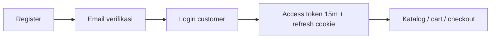
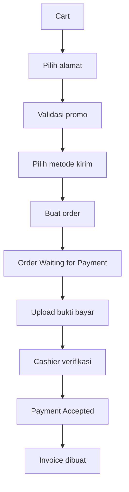

# 02 — GAMBARAN SISTEM

## Ringkasan Produk

Gala Print melayani dua sisi dalam satu aplikasi:

1. **Storefront (B2C)** — katalog produk percetakan, produk custom, keranjang, checkout, pembayaran manual (upload bukti), pelacakan order, invoice, chat, review, dan halaman profil.
2. **Operasional internal (B2B/back-office)** — manajemen order lintas peran, approval desain/pembayaran, pengiriman, produk/kategori, promo, konten homepage, akun staff, permission, activity log, ekspor database/upload, dan rekap pendapatan harian.

## Peta Fitur

| Domain | Fitur utama | Modul kunci |
|---|---|---|
| Katalog | daftar/cari produk, kategori, atribut dinamis, harga varian, produk tersembunyi | `products.service.js`, `ProductsSection.jsx`, `CatalogProductPage.jsx` |
| Keranjang | CRUD item, sinkronisasi guest→login, isolasi per user | `cart.service.js`, `CartContext.jsx` |
| Checkout | alamat, promo, ongkir/metode, bukti bayar, invoice otomatis | `orders.service.js`, `CheckoutPage.jsx` |
| Order standar | buat, lihat, timeline status, catatan, edit staff, tracking | `orders.service.js`, `OrdersSection.jsx` |
| Order custom | upload desain, order oleh customer/staff, harga manual | `createCustomOrder`, `CustomOrderPage.jsx` |
| Order offline | transaksi toko, pemilik/admin/cs/offline, billing per m² | `OfflineOrderSection.jsx`, `offlinePerM2Billing` |
| Produksi | transisi status per role, approval gate, riwayat | `TRANSITIONS`, `order_approvals` |
| Pembayaran | bukti bayar, DP, status pembayaran invoice | `invoice.service.js`, `CashierPaymentModal` |
| Invoice | nomor INV/YYYY/MM/NNNNNN, PDF server, kirim email | `invoice.service.js`, `invoicePdf.js` |
| Chat | chat customer↔staff, DM staff↔staff, file, unread | `chat.service.js`, `chat.controller.js`, `socket/index.js` |
| Review | rating + foto, hanya item yang dibeli | `reviews.service.js` |
| Promo | kode, validasi, usage log, statistik | `promo.service.js` |
| Homepage | hero multi-banner, design showcase, category banner | `homepage.service.js` |
| Analitik | kunjungan, product view, revenue, best seller, reset | `analytics.service.js` |
| Rekap harian | transaksi manual per kanal + order, rentang tanggal | `revenue.service.js` |
| Akun & permission | customer/staff, promote/revoke, feature permission | `accounts.service.js`, `adminAccounts.service.js` |
| Activity log | batch event, unread, read-all, retensi, PDF | `activityLog.service.js`, `jobs/activityLogPurge.js` |
| Ekspor | database SQL, daftar upload, gabungan | `export.controller.js` |
| Notifikasi | email transaksional + preferensi 8 kategori | `email.service.js`, `notifications.service.js` |

## Aktor dan Hak Akses Ringkas

| Peran | Tabel | Kemampuan inti |
|---|---|---|
| `customer` | `users_customer` | katalog, cart, order, chat, review, alamat, profil, invoice sendiri |
| `cashier` | `users_admin` | lihat order, konfirmasi pembayaran, order offline, invoice, rekap |
| `cs` | `users_admin` | approve desain, catatan, edit order, order custom |
| `operational` | `users_admin` | mulai produksi |
| `qc` | `users_admin` | QC, pengiriman, tracking, pickup |
| `admin` | `users_admin` | hampir semua operasi + kelola konten/produk/promo |
| `owner` | `users_admin` | analitik, akun, permission, export, reset revenue, hapus user |
| `offline` | `users_admin` | order offline, dashboard offline, rekap harian |
| `is_promoted_admin` | `users_admin` | penanda admin dinamis; akses ditentukan `admin_permissions` (namun penegakan belum menyeluruh) |

## Alur Bisnis Utama

### 1. Registrasi & Login Customer



- Registrasi memvalidasi nama, email, telepon, password ≥6, gender, tanggal lahir (`auth.routes.js`).
- Verifikasi email memakai token di `users_customer`.
- Login menghasilkan access token (dikirim via body/response) dan refresh token (cookie httpOnly) — lihat `06-authentication-authorization.md`.

### 2. Checkout Standar



- Order dan item disimpan dalam transaksi; harga item di-snapshot.
- Nomor order dibuat di dalam transaksi (`generateOrderNumber`).
- Invoice otomatis dibuat saat order dibuat/dikonfirmasi (`invoice.service.js`).
- Diskon disimpan sebagai JSON (`orders.discounts`, `order_items.discounts`).

### 3. Produksi

```
Waiting for Payment
  → Payment Accepted (cashier)
  → Waiting for Design Approval (cs)
  → Design Accepted (cs/operational)
  → On Progress (operational)
  → Quality Checking (qc)
  → In Delivery (qc)
  → Finished (qc)
```

`Cancelled` dapat terjadi pada tahap awal. Matriks lengkap per role ada di `07-order-lifecycle.md`.

### 4. Order Custom / Offline

- **Custom customer**: pilih produk/jasa, unggah desain, isi atribut, submit → order `custom`.
- **Custom staff**: CS/admin membuat order atas nama customer.
- **Offline**: offline/admin/cs mencatat transaksi toko; mendukung billing per m²; masuk rekap harian.

### 5. Pasca-pesanan

- Customer memantau `/status` atau `/my-orders`.
- Review hanya untuk item yang sudah dibeli dan belum direview (`/api/reviews/reviewed-items`).
- Invoice dapat diunduh PDF (customer terkait/staff) dan dikirim email.
- Chat customer↔staff realtime; staff dapat DM sesama staff.

## Integrasi Eksternal

| Integrasi | Penggunaan | Konfigurasi |
|---|---|---|
| MySQL | seluruh data | `DB_HOST`, `DB_PORT`, `DB_NAME`, `DB_USER`, `DB_PASSWORD` |
| Resend | email verifikasi, reset password, notifikasi order, invoice, promo, alert login | `RESEND_API_KEY`, `RESEND_FROM_EMAIL`, `ADMIN_EMAIL`, `FRONTEND_URL` |
| Socket.IO | chat, unread, DM, notifikasi admin | `CLIENT_ORIGIN` |
| Hostinger | hosting Node + MySQL, static build | `PORT`, `NODE_ENV`, `UPLOAD_DIR` |
| jsPDF (klien) | nota/receipt thermal | — |
| PDFKit (server) | invoice PDF | — |

## Environment Variable

| Nama | Wajib | Default / catatan |
|---|---|---|
| `NODE_ENV` | tidak | `development` |
| `PORT` | tidak | `3001` |
| `DB_HOST` | **ya** | — |
| `DB_PORT` | tidak | `3306` |
| `DB_NAME` | **ya** | — |
| `DB_USER` | **ya** | — |
| `DB_PASSWORD` | **harus ada** | boleh string kosong |
| `JWT_ACCESS_SECRET` | **ya** | — |
| `JWT_REFRESH_SECRET` | **ya** | — |
| `JWT_ACCESS_EXPIRES_IN` | tidak | `15m` |
| `JWT_REFRESH_EXPIRES_IN` | tidak | `7d` |
| `BCRYPT_ROUNDS` | tidak | `12` |
| `UPLOAD_DIR` | tidak | `./uploads` |
| `CLIENT_ORIGIN` | tidak | `http://localhost:5173`; mendukung daftar dipisah koma |
| `RESEND_API_KEY` | tidak | bila kosong, pengiriman email gagal/no-op `[TIDAK TERVERIFIKASI]` |
| `RESEND_FROM_EMAIL` | tidak | `noreply@galaprintofficialbali.co.id` |
| `ADMIN_EMAIL` | tidak | penerima alert order baru |
| `FRONTEND_URL` | tidak | `http://localhost:5173` |
| `VITE_USE_BACKEND` | tidak | bila `true`, frontend memakai API; default `true` hanya di build produksi |
| `VITE_API_URL` | tidak | base API/proxy; kosong = same-origin |

Validasi env dilakukan di `server/src/config/env.js`; proses **exit(1)** bila variabel wajib hilang. Tidak ada validasi panjang/entropi secret.

## Mode Operasi

| Mode | Frontend | Backend |
|---|---|---|
| Development terpisah | Vite `:5173`, `VITE_USE_BACKEND=true` | Express `:3001`, proxy `/api` |
| Produksi same-origin | build di `dist/`, disajikan Express | Express menyajikan API + `dist/` |
| API-only | frontend eksternal | jika `dist/` tidak ditemukan, hanya API |

## Ketergantungan pada Mode

- `src/core/httpClient.js` menentukan backend dari `VITE_USE_BACKEND` (default: `PROD`). Bila `false`, beberapa service memakai fallback `localStorage` — perilaku ini perlu diwaspadai saat debugging data “hilang”.
- Produksi tidak membutuhkan `VITE_API_URL` bila frontend dan backend satu origin.

BERSAMBUNG ke `03-architecture.md`
