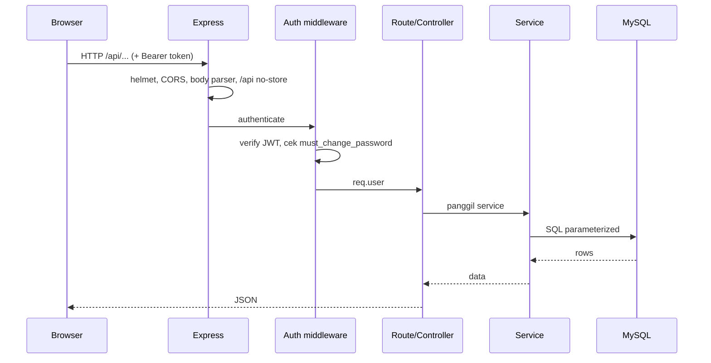
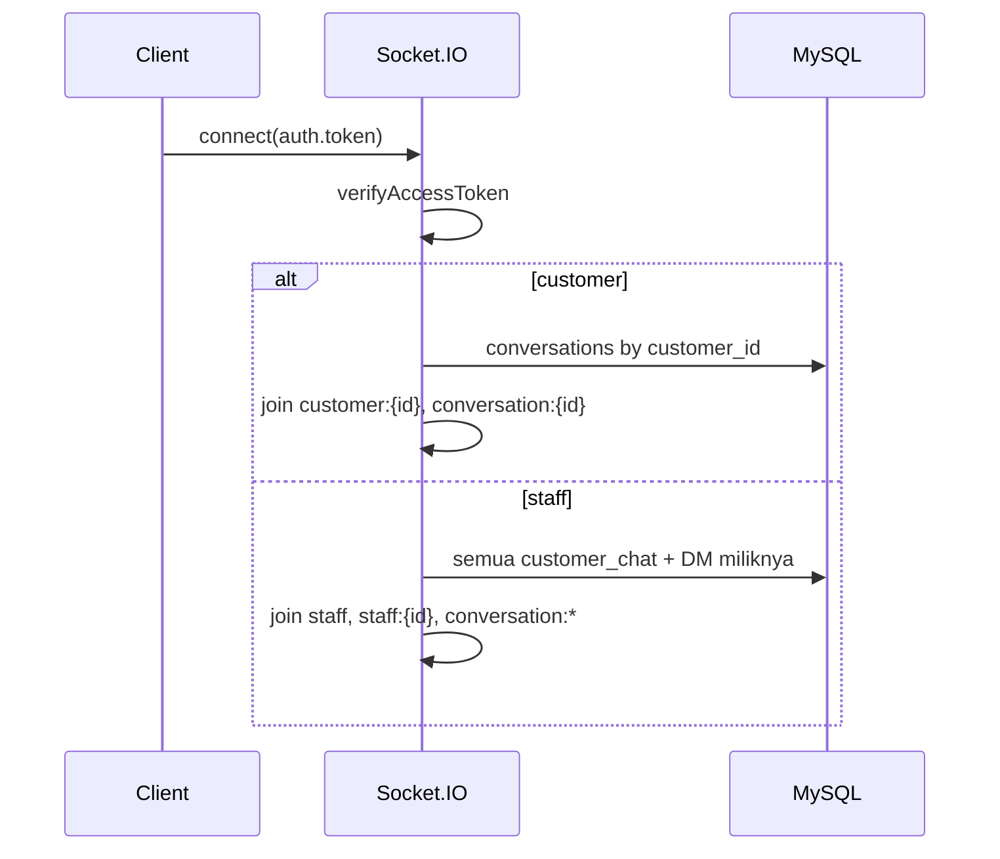

# 03 — ARSITEKTUR

## Bentuk Arsitektur

Sistem adalah **monolit dua bagian dalam satu repository**:

```
Browser
  │  HTTPS
  ▼
Express (server/) ── static /assets, /uploads, dist/index.html
  │        │
  │        ├── REST /api/*
  │        └── Socket.IO (chat, notifikasi)
  ▼
MySQL (mysql2 pool, connectionLimit 10)
```

- Tidak ada message broker, cache eksternal, atau worker terpisah.
- Satu proses Node menangani HTTP API, Socket.IO, static file, dan job retensi activity log.
- Frontend tidak memakai SSR; seluruh rendering di klien.

## Struktur Repository

```
.
├── src/                         # frontend React
│   ├── components/
│   │   ├── charts/              # Chart.js wrapper
│   │   ├── context/             # Auth, Cart, Socket, ActivityTracker
│   │   ├── guards/              # RoleGuard
│   │   ├── layout/              # PublicLayout
│   │   ├── modals/              # 7 modal operasional
│   │   ├── pages/               # public, admin, owner, staff, subadmin, offline, shared
│   │   ├── shared/  staff/  ui/
│   ├── config/                  # roles, permissions (duplikasi backend)
│   ├── core/                    # httpClient, config, socket, storage
│   ├── hooks/                   # useAdminSound, useLogUnreadBadge, useOrderList
│   ├── i18n/                    # id, en, bal
│   ├── services/                # 13 service + api/homepageService, api/invoiceService
│   ├── styles/                  # base, components, layout, pages (33 CSS)
│   ├── test/                    # 16 test file
│   ├── App.jsx  main.jsx
├── server/
│   ├── index.js                 # wrapper Hostinger → src/server.js
│   ├── start.js                 # entry alternatif
│   ├── vitest.config.js
│   └── src/
│       ├── app.js               # factory Express (tanpa listen)
│       ├── server.js            # HTTP + Socket.IO + startup tasks
│       ├── config/              # env, roles, features
│       ├── routes/              # 21 router
│       ├── controllers/         # 20 controller
│       ├── services/            # 22 service
│       ├── middleware/          # auth, requireRole, checkFeature, upload, error
│       ├── db/                  # connection, migrate, seed, ensure*, migrations
│       ├── socket/index.js
│       ├── jobs/activityLogPurge.js
│       ├── utils/               # jwt, hash, storage, discount, invoicePdf, pagination
│       └── tests/               # 37 test
├── scripts/                     # generate-sounds, optimize-images
├── docs/                        # css-housekeeping + audit
├── dist/                        # build frontend (tracked di git)
├── .github/workflows/node.js.yml
├── vite.config.js  eslint.config.js  package.json
└── README.md
```

## Backend

### Bootstrap

1. `server/index.js` (Hostinger) hanya me-re-export `./src/server.js`.
2. `server/src/server.js`:
   - menulis `startup-diag.log`;
   - memvalidasi env saat import `config/env.js` (exit 1 bila wajib hilang);
   - `testConnection()` (gagal DB hanya warning, server tetap lanjut);
   - `ensureUploadDirs()`;
   - `ensureHomepageTables()` dan `ensureActivityLogTables()` (self-healing DDL);
   - menjalankan `startActivityLogPurgeJob()` (best-effort);
   - `createApp()`, `http.createServer`, `initSocket(server)`, `listen`.
3. `server/src/app.js` adalah factory; **tidak** memanggil `listen`, sehingga bisa dipakai test.

### Urutan Middleware (penting)

Urutan di `createApp()` menentukan perilaku:

1. `app.set('trust proxy', 1)` — agar rate limit membaca IP asli di balik proxy Hostinger.
2. `GET /diag`, `GET /diag/log` — **tanpa auth** (lihat risiko).
3. `helmet()`.
4. `compression()`.
5. CORS allowlist dari `CLIENT_ORIGIN` (bisa banyak origin dipisah koma), `credentials: true`.
6. `express.json({ limit: '1mb' })`, `express.urlencoded`, `cookieParser`.
7. Logging: `morgan('dev')` di dev; logger sederhana di produksi.
8. Static `/uploads` (maxAge 30 hari) dari `UPLOAD_DIR`.
9. Middleware `/api` menetapkan `Cache-Control: no-store` untuk semua respons API.
10. Mount 21 router API.
11. Static frontend (jika `dist/` ada):
    - `/assets` → `max-age=1y, immutable`;
    - `GET /` → `index.html` dengan `no-cache`;
    - static lain → `max-age=7d`, kecuali `index.html` dipaksa `no-cache`.
12. SPA catch-all `GET *` → `index.html`, kecuali `/api`/`/uploads` → 404 JSON.
13. 404 JSON.
14. `errorHandler` (terakhir).

Konsekuensi:
- API tidak akan tersentuh static middleware.
- Route `/diag` berada **sebelum** helmet/CORS/auth.
- Semua respons API `no-store`, kecuali route yang menimpanya.

### Pola Layering

```
routes → controllers → services → db/connection (query) → MySQL
                 ↘ utils / email / storage
```

- **Route** = path, auth, role, rate limit, upload middleware.
- **Controller** = validasi request/response, status code.
- **Service** = logika bisnis, transaksi, query SQL.
- **Util** = jwt, hash, storage, diskon, PDF, pagination.
- Tidak ada ORM; SQL ditulis manual dan parameterized.
- Tidak ada repository/unit-of-work formal; transaksi memakai `getConnection()` dan `commit/rollback` di service.

### Transaksi & Konsistensi

- Order, invoice, promo usage, dan history memakai transaksi DB.
- Nomor order dan nomor invoice memakai tabel sequence + `SELECT ... FOR UPDATE`.
- Setelah migrasi `054`, **tidak ada FK** dari tabel domain ke user; validasi keberadaan user dilakukan aplikasi.
- `ensureHomepageTables`/`ensureActivityLogTables` menjalankan DDL saat startup — berguna untuk deploy, tetapi menambah ketergantungan hak DDL runtime.

### Error Handling

`middleware/errorHandler.js`:
- `entity.too.large` → 422;
- `LIMIT_FILE_SIZE` → 422 dengan batas MB;
- `status 415` → 422 format file;
- selain itu memakai `err.status || 500`;
- di produksi pesan 500 diganti generik;
- stack hanya dikirim saat dev.

Controller umumnya mengembalikan `{ ok: false, message }`; sukses bervariasi antara `{ ok:true, data }`, array langsung, atau objek domain `[TIDAK TERVERIFIKASI]` per endpoint — lihat `05-api-reference.md`.

## Frontend

### Provider Tree

`src/App.jsx`:

```
AuthProvider
└── SocketProvider
    └── CartProvider
        ├── CartWarningBanner
        ├── Toast
        └── BrowserRouter
            ├── AuthNavigationHandler
            ├── ActivityTrackerProvider
            └── Suspense → Routes
```

Implikasi:
- `SocketProvider` berada di dalam `AuthProvider` sehingga token user tersedia.
- `CartProvider` berada di dalam `SocketProvider`.
- Routing baru tersedia setelah semua provider; `AuthNavigationHandler` menangani redirect berbasis status auth.

### Routing

- `PublicLayout` membungkus halaman publik: `/`, `/products`, `/products/:id`, `/cart`, `/checkout`, `/register`, `/status`, `/my-orders`, `/cara-order`, `/custom-order`, `/portfolio`, `/tentang-kami`, `/profile`, verifikasi email, forgot/reset/change password.
- Dashboard admin/owner/offline di-lazy-load (`React.lazy` + `Suspense`) untuk memisahkan chunk.
- Guard frontend `RoleGuard` memeriksa role dari context; ini **bukan** pengganti otorisasi server.

### HTTP Client

`src/core/httpClient.js`:
- `USE_BACKEND` menentukan mode API vs fallback lokal.
- `API_BASE = VITE_API_URL || ''` (same-origin default).
- Access token disimpan **in-memory** (`_accessToken`), bukan `localStorage`.
- `clearSession()` memicu event `gala:session-expired`.
- Instance axios `api` dipakai service dan sebagian komponen langsung.

### Service Layer

Hanya 13 service utama + 2 di `src/services/api/`:

`accounts`, `activityLog`, `addressService`, `adminManagement`, `analyticsService`, `auth`, `cartService`, `categories`, `chatService`, `orders`, `products`, `profileService`, `reviews`, `homepageService`, `invoiceService`.

Banyak komponen memanggil `api` langsung (export, promo, revenue, upload, chat file, checkout promo, homepage kategori). Tidak ada generated client/OpenAPI.

### Build

`vite.config.js`:
- `backendTarget = VITE_API_URL || http://localhost:3001`;
- proxy `/api`;
- plugin compression (gzip/brotli);
- output `dist/`.

Root `npm run build` juga menjalankan `npm install --omit=dev` di `server/`, sehingga artefak deploy mencakup dependency produksi backend.

## Alur Request

### REST



### Socket.IO



Detail event dan emitter ada di `10-realtime-chat-notifications.md`.

## Deploy

- Target: Hostinger (Node.js hosting).
- `README.md` menjelaskan build, env, dan struktur deploy.
- Frontend dan backend biasanya satu origin; `dist/` disajikan Express.
- `UPLOAD_DIR` dapat berupa path absolut persisten Hostinger.
- `server/index.js` disediakan sebagai entry yang diharapkan panel hosting.
- **Catatan:** `dist/` ikut ter-commit (171 file), sehingga deploy bisa memakai artefak lama bila lupa build.

## Keputusan Arsitektur yang Perlu Dicatat

| Keputusan | Konsekuensi |
|---|---|
| Monolit + static serving | deploy sederhana, tetapi coupling frontend/backend dan satu titik gagal |
| SQL manual | kontrol penuh, tetapi rawan duplikasi query dan sulit refactor |
| Dua tabel user | domain lebih jelas, tetapi seluruh relasi kehilangan FK |
| Permission dinamis + role hardcoded | fleksibel di UI, tetapi dua sumber kebenaran |
| Status order berbasis string | mudah dibaca, tetapi rawan nilai usang/typo |
| JSON diskon di order | mendukung diskon kompleks, tetapi sulit di-query/agregasi |
| `dist/` tracked | deploy cepat, tetapi risiko artefak usang dan merge conflict |

BERSAMBUNG ke `04-data-model.md`
