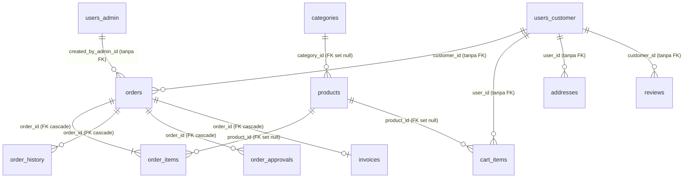

# 04 — MODEL DATA

## Ringkasan

- Database: MySQL/MariaDB, `utf8mb4`, engine InnoDB.
- Akses: `mysql2/promise` pool (`connectionLimit: 10`, `timezone: '+00:00'`).
- Tidak ada ORM. Semua query manual dan parameterized.
- ID domain memakai `CHAR(36)` (UUID); beberapa tabel log memakai `BIGINT AUTO_INCREMENT`.
- Waktu disimpan UTC; konversi tampilan dilakukan di aplikasi.
- Migrasi dijalankan berurutan oleh `server/src/db/migrate.js` dari `server/src/db/migrations/*.sql`.

## Peta Tabel

### Identitas & Akses

| Tabel | Kolom kunci | Catatan |
|---|---|---|
| `users_customer` | `id`, `name`, `email UNIQUE`, `phone`, `password_hash`, `is_email_verified`, token verifikasi/reset, `deleted_at` | dibuat migrasi 053; **tanpa** kolom role |
| `users_admin` | `id`, `role ENUM(...)`, `name`, `email UNIQUE`, `password_hash`, `is_promoted_admin`, `must_change_password`, `deleted_at` | dibuat 053; role staff |
| `refresh_tokens` | `id`, `user_id`, `user_type ENUM('customer','admin')`, `token_hash`, `family`, `used_at`, `expires_at` | `user_type` ditambah 053; FK ke `users` dicabut |
| `user_permissions` | `user_id`, `permission_key` (VARCHAR 50), UNIQUE pasangan | permission granular lama |
| `features` | `key UNIQUE`, `label`, `category`, `description` | katalog fitur dinamis (049) |
| `admin_permissions` | `user_id`, `feature_key`, `granted`, UNIQUE pasangan | permission dinamis (049) |

Catatan penting: tabel legacy `users` **dihapus** oleh migrasi `055_drop_legacy_users_table.sql` setelah `054` mencabut seluruh FK. Semua relasi user saat ini **tanpa foreign key**.

### Katalog

| Tabel | Kolom kunci | Catatan |
|---|---|---|
| `categories` | `id`, `name UNIQUE` | — |
| `products` | `id`, `category_id`, `name`, `slug UNIQUE`, `price_customer`, `price_broker`, `short_description`, `attributes JSON`, `requires_design`, `image_path TEXT`, `size_type ENUM('per_m2','none')`, `is_hidden_from_customer` | harga di-rename 046; atribut dinamis 051; atribut varian lama dihapus 050 |
| `homepage_hero` | `id`, `title`, `subtitle`, `image_path TEXT`, `cta_url`, `sort_order`, `is_active` | multi-slide (033) |
| `homepage_design_items` | `id`, `title`, `image_path`, `link_url`, `sort_order`, `is_active` | showcase |
| `homepage_cat_banners` | `id`, `category_id`, `title`, `image_path`, `link_url`, `cta_text` | FK kategori |

`products.category_id` masih memiliki FK ke `categories` (`ON DELETE SET NULL`). `homepage_cat_banners.category_id` → `categories` (`ON DELETE CASCADE`).

### Transaksi

| Tabel | Kolom kunci | Catatan |
|---|---|---|
| `orders` | `id`, `order_number UNIQUE`, `order_type`, `source`, `customer_id`, `customer_name`, `customer_type ENUM('customer','broker')`, `customer_phone`, `customer_email`, `customer_address`, `customer_address_title`, `status`, `subtotal`, `shipping_cost`, `tax_amount`, `refund_amount`, `payment_method`, `promo_code`, `discount_amount`, `discounts JSON`, `admin_note`, `created_by_admin_id`, `cancellation_reason`, `tracking_number`, `courier_name`, `payment_proof_path`, `delivery_method`, `pickup_location`, `pickup_ready_at` | status divalidasi CHECK hanya 9 nilai (016); `created_by_admin_id` ditambah 062 |
| `order_items` | `id`, `order_id`, `product_id`, `name`, `price`, `quantity`, `attributes JSON`, `discounts JSON`, `length_cm`, `width_cm`, `notes`, `design_file_path` | `price` = snapshot harga satuan; `color/size/material` dihapus 050 |
| `order_history` | `id`, `order_id`, `from_status`, `to_status`, `actor_id`, `cancellation_reason`, `created_at` | timeline status; FK order cascade |
| `order_approvals` | `id`, `order_id`, `stage`, `approved_by`, `approved_role`, `approved_name`, `approved_at`, UNIQUE(`order_id`,`stage`) | lock per tahap |
| `order_sequence` | `id=1`, `last_seq` | nomor order |
| `invoices` | `id`, `invoice_number UNIQUE`, `order_id`, `customer_id`, `subtotal`, `discount_amount`, `tax_amount`, `total`, `dp_amount`, `dp_paid_at`, `payment_status ENUM('unpaid','paid','dp')`, `payment_method`, `notes`, `created_by`, `paid_at`, `pdf_path`, `locked` | 040 + 043 + 061 + 063 |
| `invoice_sequence` | `id=1`, `last_seq` | format `INV/YYYY/MM/NNNNNN` |
| `cart_items` | `id`, `user_id`, `product_id`, `name`, `price`, `quantity`, `attributes JSON`, `notes`, `design_file_path` | isolasi cart per user |
| `addresses` | `id`, `user_id`, `title`, `name`, `phone`, `full_address` | tanpa FK setelah 054 |

Relasi inti:

### Promo & Pemasaran

| Tabel | Kolom kunci | Catatan |
|---|---|---|
| `promo_codes` | `id`, `code UNIQUE`, `type ENUM('percentage','fixed')`, `value`, `max_uses`, `daily_limit`, `min_purchase`, `max_discount`, `usage_count`, `expires_at`, `is_active`, `description` | 018 + 027 |
| `promo_usage_log` | `promo_code_id`, `order_id`, `user_id`, `customer_name`, `customer_email`, `discount_amount`, `order_subtotal`, `used_at` | FK ke promo & order |
| `reviews` | `id`, `product_id`, `order_id`, `order_item_id`, `customer_id`, `customer_name`, `rating`, `comment`, `photo_url`, UNIQUE(`customer_id`,`order_item_id`) | 010 + 026 + 035 |

### Chat

| Tabel | Kolom kunci | Catatan |
|---|---|---|
| `conversations` | `id`, `customer_id NULL`, `customer_name`, `assigned_admin_id`, `conversation_type ENUM('customer_chat','staff_dm')`, `dm_participant_a`, `dm_participant_b`, `last_at`, `hidden_by_admin` | 008 + 022 + 030; unique DM pair |
| `messages` | `id`, `conversation_id`, `sender_id`, `sender_role`, `type ENUM('text','file')`, `content`, `file_path`, `file_name`, `file_size`, `mime_type`, `read_at`, `created_at` | FK conversation cascade |

Catatan: `conversations.customer_id` menjadi nullable untuk DM. Tidak ada validasi DB bahwa peserta DM adalah staff.

### Analitik, Rekap, Log

| Tabel | Kolom kunci | Catatan |
|---|---|---|
| `analytics_visits` | `visit_date UNIQUE`, `count` | agregat harian |
| `analytics_product_views` | `product_id`, `view_date`, `count`, UNIQUE | agregat per produk/hari |
| `manual_revenue_transactions` | `id`, `transaction_date`, `source_category ENUM('offline_store','shopee','tokopedia','tiktok_shop')`, `amount`, `notes`, `created_by`, `updated_by`, `deleted_at` | 042; FK user dicabut 054 |
| `revenue_reset_log` | `id`, `performed_by`, `performed_at`, `orders_deleted`, `visits_deleted`, `views_deleted`, `note` | audit reset owner |
| `notification_preferences` | `user_id PK`, 8 flag boolean | 029 + 041; tanpa FK |
| `activity_logs` | `id BIGINT`, `actor_type`, `actor_id`, `actor_name`, `actor_role`, `action_label`, `page_path`, `target_type`, `target_id`, `metadata JSON`, `ip_address`, `created_at` | sengaja tanpa FK; snapshot |
| `activity_log_reads` | `log_id`, `reader_user_id`, `read_at`, PK gabungan | tanpa FK |
| `app_settings` | `setting_key PK`, `setting_value`, `updated_at` | retensi log |

## Riwayat Migrasi

| Rentang | Isi |
|---|---|
| 001–013 | skema awal: users, categories, products, orders, items, history, cart, conversations, messages, reviews, analytics, refresh token |
| 014–021 | gender/dob, sequence order, CHECK status, varian harga, promo, kolom promo/cancellation |
| 022–031 | DM, avatar, alamat, judul alamat, review per item, promo lanjutan, usage log, notifikasi, hidden chat, image TEXT |
| 032–040 | homepage dinamis, hero multi, finansial order, foto review, log reset revenue, verifikasi email/reset, approval, delivery method, invoice |
| 041–052 | preferensi notifikasi baru, transaksi manual, invoice nullable, email order, permission, harga broker, size type/visibility, dimensi, fitur/permission dinamis, hapus atribut varian, atribut dinamis, diskon JSON |
| 053–056 | split users, cabut FK, hapus tabel users, `must_change_password` |
| 057–059 | activity logs, read-state, app settings |
| 060 | **tidak ada** |
| 061–063 | DP invoice, `created_by_admin_id`, `dp_paid_at` |

## Sumber Kebenaran Skema

| File | Status |
|---|---|
| `server/src/db/migrations/*.sql` | **Sumber utama**; dijalankan berurutan |
| `server/src/db/migrations/combined_schema.sql` | **Usang** — masih memakai `users` legacy; belum memuat 052+ (diskon, split user, activity log, DP) |
| `server/src/db/schema_full_001_051.sql` | Snapshot sampai 051; juga memakai model user lama |
| `ensureHomepageTables.js` | DDL idempoten saat startup untuk tabel homepage |
| `ensureActivityLogTables.js` | DDL idempoten saat startup untuk activity log |

`[REKOMENDASI]` Jadikan migrasi sebagai satu-satunya sumber, buang/regenerasi dump, dan tambahkan pengecekan checksum migrasi.

## Integritas & Konsistensi

### Kekuatan

- Transaksi untuk order, invoice, dan promo usage.
- Unique constraint pada `order_number`, `invoice_number`, `slug`, `email`, pasangan DM, dan review per item.
- CHECK pada `orders.status` (9 status) dan `reviews.rating` (1–5).
- Sequence memakai `FOR UPDATE` untuk menghindari duplikasi nomor.
- Snapshot harga/nama pada `order_items` melindungi histori dari perubahan produk.

### Kelemahan

1. **Tidak ada FK ke user** setelah 054 — penghapusan user dapat meninggalkan order/chat/address/review orphan.
2. **Tidak ada FK pada beberapa tabel baru** (activity log, read state, notification prefs) — by design, tetapi perlu job pembersihan.
3. **Status berupa string** — konsistensi bergantung kode; daftar status muncul di beberapa tempat dan sudah ada nilai usang.
4. **JSON tanpa skema** — `attributes`, `discounts`, `metadata` tidak divalidasi di level DB.
5. **`manual_revenue_transactions`** masih menyimpan `created_by`/`updated_by` tanpa FK, dan memakai soft delete.
6. **`combined_schema.sql` drift** — rebuild dari dump akan menghasilkan skema berbeda dari produksi.
7. **Kolom `users` legacy di file lama** dapat menyesatkan developer baru.
8. **Tidak ada kolom versi optimistik** (`updated_at` bukan concurrency token) — edit bersamaan bisa saling menimpa.

## Data Sensitif

| Data | Lokasi | Perlindungan |
|---|---|---|
| `password_hash` | `users_customer`, `users_admin` | bcrypt (default 12 rounds) |
| Token verifikasi/reset | kolom token (hash SHA-256) | expiry |
| Refresh token | `refresh_tokens.token_hash` | SHA-256, family, expiry, used_at |
| Alamat/telepon customer | `orders`, `addresses` | otorisasi route (lihat temuan IDOR) |
| Bukti pembayaran | file di `UPLOAD_DIR/payments` + path di order | static `/uploads` **publik** |
| File desain | `UPLOAD_DIR/designs` | static `/uploads` **publik** |
| Log aktivitas | `activity_logs` | route staff |

Catatan: seluruh file di `/uploads` disajikan tanpa autentikasi (`app.use('/uploads', express.static(...))`). Siapa pun yang mengetahui URL dapat mengunduh bukti bayar/desain.

BERSAMBUNG ke `05-api-reference.md`
