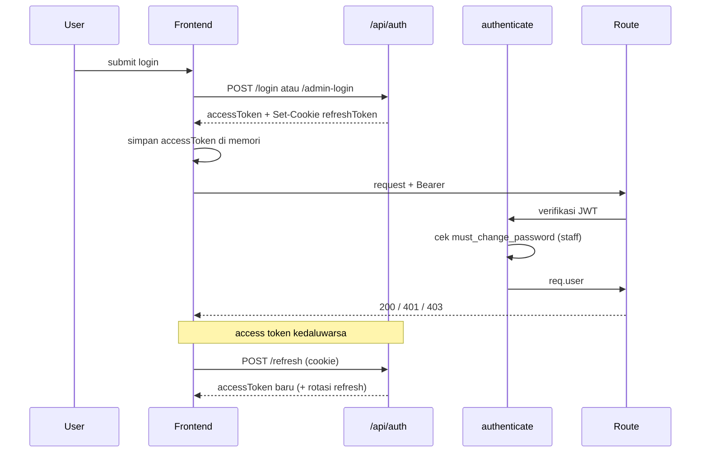

# 06 — AUTENTIKASI & OTORISASI

## Model Identitas

Sistem memakai **dua domain akun terpisah**:

| Domain | Tabel | Login | Role |
|---|---|---|---|
| Customer | `users_customer` | `POST /api/auth/login` | implisit `customer` |
| Staff | `users_admin` | `POST /api/auth/admin-login` | `admin`, `owner`, `cashier`, `cs`, `operational`, `qc`, `offline` |

`server/src/config/roles.js`:

```js
export const STAFF_ROLES = ['admin','owner','cashier','cs','operational','qc','offline'];
```

Tidak ada endpoint login universal: customer dan staff dipisah untuk mengurangi kebocoran role.

## Registrasi Customer

`customerAuth.register()`:
- validasi route: nama, email valid, phone 8–20 digit/`+`/`-`/spasi, password ≥6, gender `L|P`, dob `YYYY-MM-DD`;
- cek email duplikat;
- hash password bcrypt (default 12 rounds);
- buat token verifikasi email (SHA-256 dari raw token);
- kirim email verifikasi via Resend;
- membuat access + refresh token dan mengembalikan `201`.

## Login

### Customer

`POST /api/auth/login`:
1. validasi email/password;
2. `customerAuth.login` mencari `users_customer` dan membandingkan bcrypt;
3. jika gagal → catat kegagalan per `(ip, email)` dan kirim alert setelah 5 kali;
4. jika `deleted_at` terisi → 401 “Akun tidak aktif”;
5. sukses → `completeLogin`.

### Staff

`POST /api/auth/admin-login` sama, tetapi query ke `users_admin` dan menyertakan `role`, `is_promoted_admin`, `must_change_password`.

### Respons Login

```json
{
  "ok": true,
  "accessToken": "...",
  "user": { "...": "..." },
  "rememberMe": false,
  "emailVerified": true,
  "mustChangePassword": false
}
```

Refresh token **tidak** ada di body; dikirim sebagai cookie `refreshToken`.

## Token

| Token | Algoritma | Payload | Masa berlaku | Penyimpanan |
|---|---|---|---|---|
| Access | JWT HS256 (`jsonwebtoken`) | `sub`, `role`, `name`, `email` | default `15m` | memori klien (`_accessToken`) |
| Refresh | JWT HS256 | `sub`, `family` | default `7d` (30d bila remember) | cookie httpOnly |

Cookie (`auth.controller.js`):

```
httpOnly: true
sameSite: production ? 'strict' : 'lax'
secure: production
path: '/'
```

Catatan: `sameSite: strict` pada produksi dapat mempersulit skenario cross-site; aplikasi saat ini same-origin sehingga aman.

## Refresh Rotation

`rotateRefreshToken` (customer & admin):

1. verifikasi JWT refresh;
2. cari baris `refresh_tokens` berdasarkan SHA-256 token;
3. jika tidak ada → 401;
4. jika `used_at` sudah terisi:
   - bila ≤ **10 detik** sejak dipakai → kembalikan access token baru + token terbaru family (tidak menerbitkan refresh baru);
   - bila > 10 detik → **hapus seluruh family** (indikasi reuse) dan 401;
5. jika belum dipakai:
   - tandai `used_at = NOW()`;
   - hitung sisa umur;
   - buat refresh baru dalam family yang sama;
   - simpan hash;
   - kembalikan access + refresh + `cookieMaxAge`.

Rotasi tidak memperpanjang family melebihi `expires_at` awal.

## Logout

- Membaca cookie, mencari `user_type` pada `refresh_tokens`, memanggil `revokeRefreshToken`.
- `revokeRefreshToken` menghapus **seluruh family**.
- Cookie dibersihkan.
- Logout tidak memerlukan access token.

## Middleware `authenticate`

`server/src/middleware/auth.js`:

1. Wajib header `Authorization: Bearer <token>`.
2. Verifikasi access token.
3. `req.user = { id, role, name, email }`.
4. Jika role **bukan** staff → lanjut (customer tidak punya `must_change_password`).
5. Jika staff:
   - URL (`tanpa query`) termasuk pengecualian `GET /api/auth/me` atau `POST /api/auth/change-password` → lanjut;
   - query `SELECT must_change_password FROM users_admin WHERE id=? AND deleted_at IS NULL`;
   - bila `1` → `403 { mustChangePassword: true }`;
   - bila query gagal → **fail-open** (`next()`).

Konsekuensi:
- Setiap request staff melakukan 1 query tambahan (indexed PK).
- Kegagalan DB pada pengecekan ini tidak memblokir akses.
- Penghapusan akun (`deleted_at`) **tidak** langsung membatalkan access token yang masih valid (≤15 menit), karena token tidak dicek ulang terhadap tabel kecuali untuk `must_change_password`.

## Otorisasi Role

`requireRole(...roles)`:
- 401 bila `req.user` tidak ada;
- 403 bila role tidak termasuk;
- tidak membaca DB.

Matriks ringkas:

| Area | Role |
|---|---|
| order list staff | semua staff |
| buat order | customer + semua staff |
| order custom staff | cs, admin |
| order offline | offline, admin, cs |
| update status | semua staff (service memvalidasi transisi) |
| catatan | admin, cs |
| edit order | cs, admin |
| tracking/pickup | qc, admin |
| hapus order | cs, admin, cashier |
| invoice lihat | cashier, admin, owner, cs, operational, qc, offline |
| invoice ubah | cashier, admin, owner |
| export | owner, admin + feature |
| akun | owner |
| buat customer account | semua staff |
| promo | admin, owner |
| fitur katalog | owner |
| activity log | staff (guard internal) |
| revenue | cashier, admin, owner |
| analitik | owner, admin (reset: owner) |

## Permission Dinamis

Dua sistem hidup berdampingan:

1. **Role hardcoded** (`requireRole`) — selalu dievaluasi.
2. **Feature permission** (`checkFeature(featureKey)`):
   - membaca `users_admin.is_promoted_admin`;
   - jika **bukan** promoted admin → `next()` (role lama yang menentukan);
   - jika promoted admin → wajib `admin_permissions.granted = 1`, else 403.

Pemakaian aktual `checkFeature`:

| Route | Feature key |
|---|---|
| `GET /api/export/database` | `export.database` |
| `GET /api/promo` | `promo.view` |

> Komentar di `checkFeature.js` masih menyebut tabel `users` dan “BELUM dipasang ke endpoint manapun”. Keduanya **usang**: kode membaca `users_admin`, dan middleware sudah dipasang di dua route.

Artinya:
- Promoted admin **tetap** harus lolos `requireRole('admin','owner')`. Jika role-nya bukan admin/owner, `checkFeature` tidak pernah dievaluasi.
- Hampir seluruh fitur lain tidak memakai `checkFeature`, sehingga permission dinamis belum menjadi kontrol akses menyeluruh.
- `user_permissions` (permission_key lama) dan `admin_permissions` (feature_key baru) adalah dua tabel berbeda; tidak jelas mana yang otoritatif `[TIDAK TERVERIFIKASI]`.

## Frontend

### AuthContext

- Saat mount: `loading=true`, memanggil `getCurrentUser()`; bila access token tidak ada, mencoba refresh.
- Menyimpan `user`, `setUser`, `login`, `logout`.
- `getUserAuthPath(user)` → `/admin/login` untuk staff, `/register` untuk customer.
- Mendengarkan event `gala:session-expired` dari `httpClient` untuk membersihkan sesi dan redirect.

### RoleGuard

`src/components/guards/RoleGuard.jsx`:
- `requiredRole` tunggal;
- bila belum login atau role tidak sama → render `NotFoundPage` (bukan redirect);
- `loading` → `null`.

Keterbatasan:
- Tidak mendukung multi-role atau hierarki.
- Owner tidak otomatis boleh membuka route `requiredRole="admin"`.
- Guard ini hanya UX; server tetap harus menolak.

### Penyimpanan Token

- Access token in-memory → hilang saat refresh halaman, lalu dipulihkan via refresh cookie.
- Tidak ada token di `localStorage`, sehingga mengurangi risiko XSS token theft, tetapi semua tab harus refresh sendiri.

## Alur End-to-End



## Lupa / Reset Password

| Alur | Service | Catatan |
|---|---|---|
| Customer lupa | `customerAuth.forgotPassword` | cari email di `users_customer`, kirim link |
| Customer reset | `customerAuth.resetPassword` | validasi token hash + expiry, hapus semua refresh customer |
| Staff lupa | `adminAuth` via `/staff/forgot-password` | scoped `users_admin` |
| Staff reset | `adminAuth` via `/staff/reset-password` | hapus semua refresh admin |
| Ganti password login | `changePassword` | verifikasi password lama, hapus refresh, terbitkan pair baru |

Generic response digunakan untuk mencegah enumerasi email pada forgot-password `[ASUMSI berdasarkan komentar controller]`.

## Verifikasi Email

- Token mentah dikirim ke email; DB menyimpan hash.
- `GET /api/auth/verify-email?token=...` mencari di kedua tabel.
- `POST /api/auth/resend-verification` memerlukan login dan dibatasi 3/menit.
- Login **tidak** diblokir bila email belum diverifikasi; hanya flag `emailVerified` yang dikembalikan. `[FAKTA]` controller tidak menolak login berdasarkan flag ini.

## Temuan Otorisasi

| # | Temuan | Severity | Bukti |
|---|---|---|---|
| A1 | `GET /api/orders/:id` tanpa ownership check | **Tinggi** | `orders.routes.js`, `orders.service.js` |
| A2 | `GET /api/orders/:orderId/invoice` tanpa cek kepemilikan | **Tinggi** | `orders.routes.js` + `getInvoiceByOrder` `[TIDAK TERVERIFIKASI detail controller]` |
| A3 | `checkFeature` tidak menyeluruh | **Tinggi** | hanya 2 route |
| A4 | `must_change_password` fail-open | **Sedang** | `auth.js` catch → `next()` |
| A5 | Access token tidak dicek terhadap `deleted_at` setiap request | **Sedang** | `auth.js` hanya cek `must_change_password` |
| A6 | `failedLoginMap` in-memory tanpa TTL | **Rendah** | `auth.controller.js` |
| A7 | `GET /diag` & `/diag/log` tanpa auth | **Sedang–Tinggi** | `app.js` |
| A8 | `/uploads` publik | **Sedang** | `app.js` |
| A9 | RoleGuard single-role, hanya UX | **Rendah** | `RoleGuard.jsx` |
| A10 | Dua tabel permission tidak jelas otoritatif | **Sedang** | `user_permissions`, `admin_permissions` |

`[REKOMENDASI]` Tambahkan policy terpusat `can(user, action, resource)` yang menangani role + ownership + feature, lalu gunakan di controller, bukan tersebar di route.

BERSAMBUNG ke `07-order-lifecycle.md`
