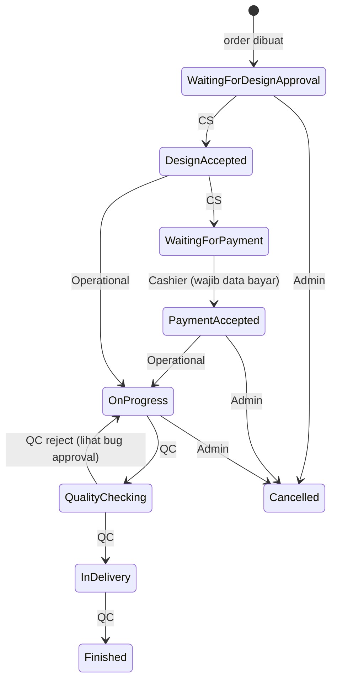

# 07 — SIKLUS HIDUP ORDER

## Ringkasan

Order adalah pusat sistem. Ia dibuat oleh customer, CS, admin, atau offline; diproses melalui status berurutan; dilengkapi invoice; lalu diarsipkan. Riwayat status dan approval disimpan terpisah dari order.

Sumber utama:
- `server/src/services/orders.service.js` (±1.001 baris)
- `server/src/services/orderApprovals.service.js`
- `server/src/services/invoice.service.js`
- `server/src/controllers/orders.controller.js`
- `src/components/modals/{OrderDetailModal,EditOrderModal,CashierPaymentModal}.jsx`

## Pembuatan Order

### Jalur Pembuatan

| Jalur | Endpoint | `source` | `order_type` | Status awal | Pembuat |
|---|---|---|---|---|---|
| Checkout online | `POST /api/orders` | `online` | `standard` (default) | `Waiting for Design Approval` | customer |
| Custom customer | `POST /api/orders/custom-customer` | `custom` | `custom` | `Waiting for Design Approval` | customer |
| Custom staff | `POST /api/orders/custom` | `custom` | `custom` | `Waiting for Design Approval` | cs/admin |
| Offline | `POST /api/orders/offline` | `offline` | `standard` | `Waiting for Design Approval` | offline/admin/cs |

> **Koreksi penting:** order **tidak** dimulai dari `Waiting for Payment`. `createOrder()` memakai default `initialStatus = 'Waiting for Design Approval'`. Alur normal adalah desain lebih dulu, lalu pembayaran.

### Data yang Disimpan

`createOrder()`:
- membuat UUID order dan **nomor order di dalam transaksi** via `generateOrderNumber(conn)` (`order_sequence` + row lock);
- meng-insert `orders` dengan snapshot customer, `customer_type`, `promo_code`, `discount_amount`, `discounts`, `admin_note`, `created_by_admin_id`;
- meng-insert `order_items` dengan snapshot `price`, `attributes`, `discounts`, `length_cm`, `width_cm`, `notes`, `design_file_path`;
- menaikkan `promo_codes.usage_count` di transaksi yang sama;
- menulis `order_history` awal;
- untuk order offline dengan status awal lanjut, melakukan **backfill** langkah sebelumnya;
- commit, lalu mencatat `promo_usage_log` (fire-and-forget);
- memicu email alert admin, auto-create invoice, dan email “Pesanan Diterima”.

### Nomor Order

- Format mengikuti `generateOrderNumber` di service `[TIDAK TERVERIFIKASI format persis]`; yang pasti: unik dan memakai sequence.
- Tracking publik memakai `order_number`.

## Daftar Status

| Status | Arti operasional |
|---|---|
| `Waiting for Design Approval` | menunggu CS memeriksa desain |
| `Design Accepted` | desain disetujui |
| `Waiting for Payment` | menunggu pembayaran |
| `Payment Accepted` | pembayaran diterima (lunas/DP) |
| `On Progress` | produksi berjalan |
| `Quality Checking` | QC |
| `In Delivery` | dikirim / siap diambil |
| `Finished` | selesai |
| `Cancelled` | dibatalkan |

CHECK constraint `chk_orders_status` hanya mengizinkan 9 nilai di atas (`016_add_status_check_constraint.sql`).

## Matriks Transisi

Sumber: `TRANSITIONS` di `orders.service.js`.

### Cashier
| Dari | Ke |
|---|---|
| Waiting for Payment | Payment Accepted, Cancelled |
| Payment Accepted | — |

### CS
| Dari | Ke |
|---|---|
| Waiting for Design Approval | Design Accepted |
| Design Accepted | Waiting for Payment |

### Operational
| Dari | Ke |
|---|---|
| Design Accepted | On Progress |
| Payment Accepted | On Progress |

### QC
| Dari | Ke |
|---|---|
| On Progress | Quality Checking |
| Quality Checking | In Delivery, **On Progress** (reject) |
| In Delivery | Finished |

### Admin
| Dari | Ke |
|---|---|
| Waiting for Payment | Payment Accepted, Cancelled |
| Payment Accepted | Waiting for Design Approval, On Progress, Cancelled |
| Waiting for Design Approval | Design Accepted, Cancelled |
| Design Accepted | On Progress, Waiting for Payment, Cancelled |
| On Progress | Quality Checking, Cancelled |
| Quality Checking | In Delivery, On Progress, Cancelled |
| In Delivery | Finished, Cancelled |

### Owner
| Dari | Ke |
|---|---|
| semua status aktif | Cancelled |

`getAllowedNextStatuses(currentStatus, role)` mengembalikan array kosong untuk pasangan yang tidak diizinkan.

## Alur Normal



Admin dapat mempercepat dengan melompati tahap (mis. `Payment Accepted → On Progress`).

## Gerbang Pembayaran

Saat transisi ke `Payment Accepted`:

1. `payment.paymentStatus` wajib `paid` atau `dp`.
2. `payment.paymentMethod` wajib tidak kosong.
3. Invoice harus ada; bila belum, `autoCreateInvoice`.
4. `computeInvoicePayment` menghitung:
   - `payment_status` (`paid`/`dp`),
   - `payment_method`,
   - `dp_amount`,
   - `locked` (1 bila paid),
   - `paid_at`, `dp_paid_at`.
5. Update order + invoice + history + approval dalam **satu transaksi**.
6. Kirim email invoice PDF (jika customer punya email) dan email status.

Aturan DP (`invoice.service.js`):
- DP harus `> 0` dan `< total`;
- status `dp` dapat diubah ke `paid`;
- `dp → selain paid` ditolak;
- invoice `locked` (paid) tidak dapat diubah;
- `dp_amount` dipertahankan sebagai histori;
- `dp_paid_at` dipertahankan walau status berubah.

Order offline wajib memiliki `payment_proof_path` sebelum melewati tahap pembayaran (`crossesCashierStage`), kecuali dibatalkan.

## Approval & Locking

`APPROVAL_STAGE_FOR_STATUS` memetakan hampir semua status ke stage dengan nama sama, kecuali `Waiting for Payment` dan `Cancelled`.

Setiap transisi non-cancel ke status yang punya stage akan:
1. memanggil `assertNotLocked(orderId, newStatus)`;
2. mencatat `order_approvals` (`UNIQUE(order_id, stage)`).

Tujuan: setelah sebuah tahap di-ACC, tahap itu tidak bisa diubah kembali.

### Konflik Logika yang Ditemukan

`assertNotLocked` memblokir **semua** transisi ke stage yang sudah pernah dicapai. Akibatnya:

- QC tidak dapat melakukan **reject** `Quality Checking → On Progress`, karena `On Progress` sudah pernah di-approve saat operational memulai produksi. Meskipun `TRANSITIONS.qc` mengizinkannya, service akan melempar 403.
- Admin juga tidak dapat mengembalikan order ke `On Progress` dari QC.
- Ini juga menghalangi “ulang tahap” apa pun yang sudah pernah dilewati.

Status: **bug fungsional** (bukan sekadar kosmetik). Perlu keputusan bisnis: lock seharusnya hanya mencegah perubahan **mundur ke tahap yang sudah final**, atau hanya mencegah **approve ganda**, bukan melarang rework.

## Edit Order oleh Staff

`PATCH /api/orders/:id/edit` (cs/admin) memanggil `updateStaffOrder`:
- dapat mengubah data customer, item, subtotal, diskon, catatan, `customer_type`;
- item di-replace/di-update sesuai implementasi service `[TIDAK TERVERIFIKASI detail]`;
- tidak boleh mengubah order yang sudah final? `[TIDAK TERVERIFIKASI]`.

## Catatan, Tracking, Pickup

| Aksi | Endpoint | Role | Service |
|---|---|---|---|
| Catatan admin | `PATCH /:id/note` | admin, cs | `updateAdminNote` |
| Nomor resi/kurir | `PATCH /:id/tracking` | qc, admin | `setTrackingNumber` |
| Metode kirim | `PATCH /:id/delivery-method` | qc, cs, admin | `setDeliveryMethod` |
| Info pickup | `PATCH /:id/pickup` | qc, admin | `setPickupInfo` |
| Bukti bayar | `POST /:id/payment-proof` | semua login | `attachPaymentProof` |
| Desain item | `POST /:id/items/:itemId/design` | semua login | `attachDesignFile` |

`delivery_method` = `delivery`, `pickup_factory`, `pickup_store`, dengan `pickup_location`, `pickup_ready_at`.

## Pembatalan

- Hanya `admin`/`owner`/`cashier` (pada `Waiting for Payment`) yang dapat membatalkan.
- Menyimpan `cancellation_reason` di `orders` dan `order_history`.
- **Menghapus file** bukti bayar dan desain dari storage.
- Tidak ada refund otomatis; `refund_amount` hanya kolom.
- Invoice tidak otomatis dihapus/di-void saat cancel `[TIDAK TERVERIFIKASI]`.

## Penghapusan Order

`DELETE /api/orders/:id` → `deleteOrder`.

Aturan `getOrderDeletePermission`:

| Role | Aturan |
|---|---|
| admin | selalu boleh |
| cashier | hanya status `Waiting for Payment` |
| cs | hanya `order_type = custom`, dan status **tidak** termasuk daftar blokir |
| lainnya | 403 |

Daftar blokir CS saat ini:

```
Payment Accepted, Waiting for Design Approval, On Progress,
Ready to Ship, Shipped, Completed
```

Masalah:
- `Ready to Ship`, `Shipped`, `Completed` **tidak ada** dalam alur status aktual.
- `Design Accepted`, `Quality Checking`, `In Delivery`, `Finished` **tidak diblokir**.
- Akibatnya CS berpotensi menghapus order custom yang sudah selesai/dikirim. **Bug otorisasi/bisnis.**

Penghapusan:
1. cek order & permission;
2. kumpulkan `payment_proof_path` + `design_file_path`;
3. transaksi: hapus invoice, item, history, approval, order;
4. setelah commit, hapus file dari storage `[TIDAK TERVERIFIKASI urutan tepat]`.

Catatan: promo usage log memiliki FK `order_id ON DELETE CASCADE`, sehingga ikut terhapus; statistik promo historis bisa berubah.

## Invoice

- Setiap order baru otomatis dibuatkan invoice (`autoCreateInvoice`, fire-and-forget). Kegagalan tidak membatalkan order.
- Nomor invoice `INV/YYYY/MM/NNNNNN` dari `invoice_sequence` dengan `FOR UPDATE`.
- Satu order satu invoice (`createInvoice` cek duplikat).
- `payment_status`: `unpaid`, `paid`, `dp`.
- `locked=1` saat paid.
- PDF dihasilkan server (`utils/invoicePdf.js`, PDFKit) dan dapat dikirim via Resend.
- Customer/staff view role dapat mengunduh PDF.

## Tracking Publik

`GET /api/orders/track`:
- publik, tanpa autentikasi;
- input `orderNumber`; `phone` opsional;
- `findOrder` mencocokkan nomor dan (bila diberikan) telepon.

Risiko: nomor order dapat ditebak/di-enumerasi; data yang dikembalikan perlu dibatasi. Detail di `12-security-review.md`.

## Notifikasi Order

| Kejadian | Email | Preferensi |
|---|---|---|
| Order dibuat | `sendOrderReceivedEmail` | `order_received` |
| Payment Accepted | `sendInvoiceEmail` + PDF | `payment_accepted` |
| Design Accepted | `sendOrderNotification` | `mockup_accepted` |
| In Delivery | `sendOrderNotification` | `order_shipped` |
| Finished | `sendOrderNotification` | `order_finished` |
| Cancelled | `sendOrderNotification` | `order_cancelled` |
| Order baru (admin) | `sendNewOrderAdminAlert` | — |

Email bersifat fire-and-forget; kegagalan hanya di-log.

## Sinkronisasi Realtime

Setelah create/update, controller memanggil emitter Socket.IO (`emitOrderNew`, dan emitter perubahan status `[TIDAK TERVERIFIKASI nama fungsi persis]`) agar dashboard staff memperbarui daftar tanpa refresh. Lihat `10-realtime-chat-notifications.md`.

## Ringkasan Risiko pada Siklus Order

| # | Risiko | Dampak |
|---|---|---|
| O1 | `GET /:id` tanpa ownership | kebocoran data order |
| O2 | Tracking publik enumerable | kebocoran status/data |
| O3 | Approval lock memblokir QC reject | order macet |
| O4 | Daftar status hapus CS usang | order selesai dapat dihapus |
| O5 | Auto-invoice fire-and-forget | order bisa tanpa invoice |
| O6 | File bukti bayar/desain publik | kebocoran dokumen |
| O7 | Tidak ada refund/void invoice otomatis saat cancel | data keuangan tidak konsisten |
| O8 | Edit staff tanpa aturan status yang jelas | order final dapat diubah |

BERSAMBUNG ke `08-backend-modules.md`
